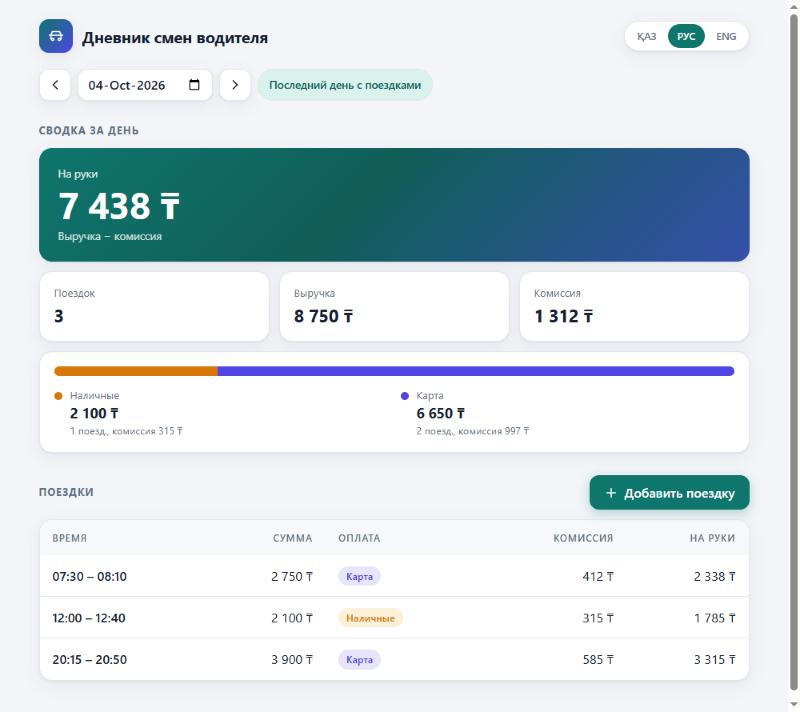
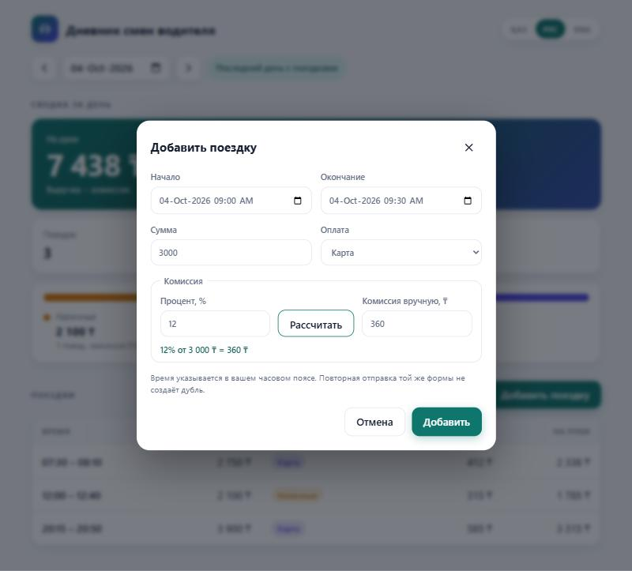
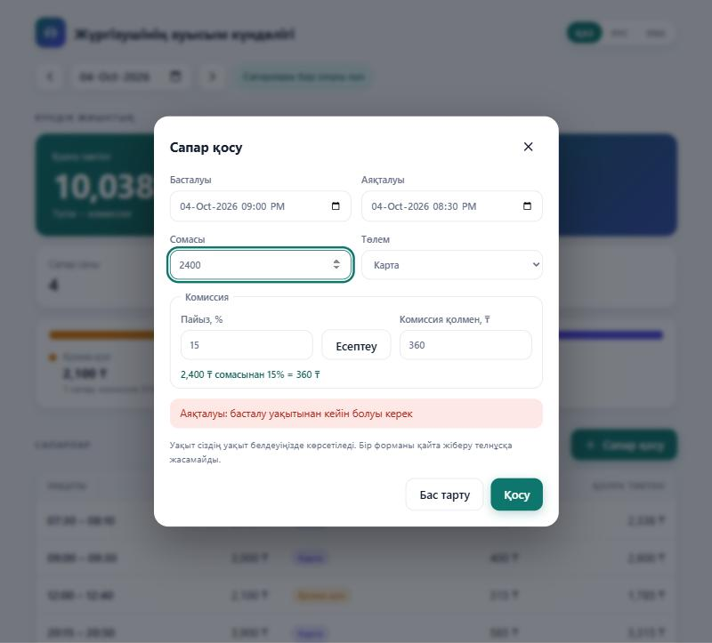
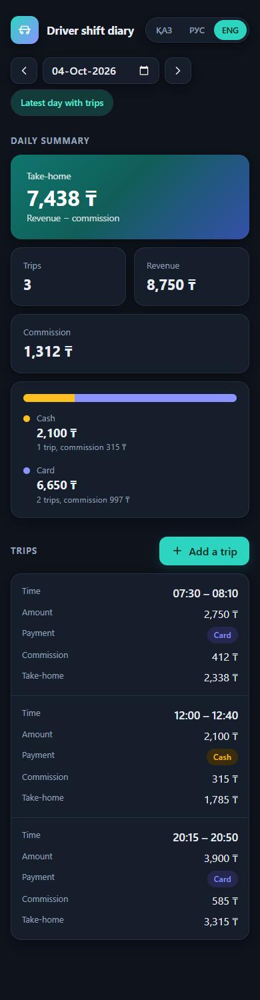

# Дневник смен водителя

Небольшое приложение: сервер на Java (Spring Boot) отдаёт поездки водителя и сводку за день, принимает новые поездки
с проверкой данных и защитой от дублей. Веб-клиент лежит в том же приложении и открывается на `http://localhost:8080`.

## Скриншоты

Сводка и список поездок за день (русский язык, светлая тема):



Окно добавления поездки открывается по кнопке «Добавить поездку». Комиссию можно задать процентом: ввести процент и
нажать «Рассчитать» (или Enter в поле процента) — значение подставится в поле «Комиссия вручную», где его можно
исправить или вписать комиссию целиком руками:



То же окно на казахском языке: сервер вернул ошибку валидации (окончание раньше начала) на выбранном языке:



Мобильная версия, тёмная тема (включается автоматически), английский язык; таблица превращается в карточки:



## Как запустить

Нужна только Java 21+ (Maven ставить не надо, есть `mvnw`).

```bash
./mvnw spring-boot:run      # Windows: mvnw.cmd spring-boot:run
```

Откройте <http://localhost:8080>. При старте поездки из `src/main/resources/seed/trips.json` загружаются в базу
(H2 в файле `./data/arqa`, папка в `.gitignore`).

Если `./mvnw` не запускается (нет права на исполнение), используйте `sh mvnw spring-boot:run`.

Тесты (105 штук: юнит-тесты, интеграционные на H2 в памяти, архитектурные; не зависят от часового пояса машины):

```bash
./mvnw verify
```

## Что сделано

| Требование | Реализация |
|---|---|
| Список поездок за день | `GET /api/trips?date=YYYY-MM-DD` |
| Сводка за день | `GET /api/summary?date=YYYY-MM-DD` |
| Добавление поездки с проверкой | `POST /api/trips` |
| Защита от дублей | идентификатор поездки (`id`) — первичный ключ в БД + сравнение данных |
| Клиент | страница со сводкой, таблицей поездок, переключением дней и формой добавления |
| Тесты | расчёт сводки, определение дня, валидация, дубли (в том числе параллельные запросы), API |

Дополнительно:

| Эндпоинт | Назначение |
|---|---|
| `GET /api/trip-dates` | даты, в которые есть поездки (клиент открывается на последней из них) |
| `GET /api/summary/range?from=&to=` | итоги за период и сводка по каждому дню, где есть поездки |
| `GET /api/trips/range?from=&to=&page=0&size=50` | поездки за период постранично (`size` 1..200, страницы с нуля) |

Период — не более 92 дней, иначе `400` с кодом `INVALID_QUERY`.

### Примеры

```bash
curl "http://localhost:8080/api/summary?date=2026-10-01"
```
```json
{"date":"2026-10-01","tripCount":3,"revenue":7100,"commission":1065,"netEarnings":6035,
 "cash":{"tripCount":2,"revenue":4700,"commission":705},
 "card":{"tripCount":1,"revenue":2400,"commission":360}}
```

```bash
curl -X POST http://localhost:8080/api/trips -H "Content-Type: application/json" \
  -d '{"id":"t9","start":"2026-10-05T08:00:00+05:00","end":"2026-10-05T08:20:00+05:00","amount":1000,"payment":"cash","commission":100}'
```

Ответы `POST /api/trips`:

| Код | Когда |
|---|---|
| `201` | поездка создана |
| `200` | та же поездка (тот же `id` и те же данные) уже есть — ничего не создано, возвращена существующая |
| `400` | данные неверны. В `violations` перечислены все проблемные поля: `{"code":"VALIDATION_FAILED","message":"Trip data is invalid","violations":[{"fieldName":"amount","code":"trip.amount.notPositive","message":"must be greater than 0"}]}`. Тело не является JSON или поле неверного типа — `MALFORMED_REQUEST` |
| `409` | поездка с таким `id` уже есть, но с **другими** данными (`TRIP_CONFLICT`) |

Все ошибки (в том числе `404`, `405`, `415` от самого Spring) приходят в одном формате `{"code","message","violations"}`,
где `code` — `VALIDATION_FAILED`, `MALFORMED_REQUEST`, `TRIP_CONFLICT`, `INVALID_QUERY`, `INVALID_PARAMETER`, `NOT_FOUND`,
`METHOD_NOT_ALLOWED`, `UNSUPPORTED_MEDIA_TYPE` или `INTERNAL_ERROR`. Внутренние детали ошибки `500` клиенту не показываются.

Правила проверки: `0 < amount ≤ 10 000 000`; `end` позже `start` (сравниваются моменты времени, а не часы на циферблате);
`0 ≤ commission ≤ amount`; `payment` — `cash` или `card`; `id` не пустой (до 100 символов); поездка длится не более 24 часов.

## Языки: казахский, русский, английский

Язык ответа API выбирается так (по убыванию приоритета): параметр `?lang=kk|ru|en`, затем заголовок `Accept-Language`, иначе английский. Неподдерживаемый язык даёт английский. Переводятся тексты ошибок (`message`, `violations[].message`); поле `code` и коды `violations[].code` стабильны и не переводятся. В ответе есть заголовок `Content-Language`.

```bash
curl -X POST "http://localhost:8080/api/trips?lang=kk" -H "Content-Type: application/json" -d "{\"id\":\"bad\",\"amount\":0}"
```

Интерфейс: главная карточка «На руки», плитки показателей, полоса соотношения наличные/карта, таблица поездок (на телефоне превращается в карточки), автоматическая тёмная тема. Форма добавления скрыта и открывается окном по кнопке «Добавить поездку»: в неё подставляется показанный день, после успешного добавления окно закрывается и показывается уведомление.

Веб-клиент имеет переключатель языка (выбор запоминается в браузере) и сам передаёт выбранный язык в `Accept-Language`. Переводы сервера лежат в `messages.properties` (en), `messages_ru.properties`, `messages_kk.properties`; `MessageBundlesTest` следит, чтобы во всех файлах были одни и те же ключи и плейсхолдеры. Переводы клиента — `static/translations.js`.

## Принятые решения и допущения

- **Какому дню принадлежит поездка.** Дню **начала** поездки в её собственном часовом поясе (смещение из `start`),
  а не в часовом поясе сервера. Поездка 23:50 → 00:15 считается днём начала. Это зафиксировано тестами, в том числе
  при серверной зоне UTC. День вычисляется при сохранении (`local_trip_date`, есть индекс).
- **«На руки»** = выручка − комиссия. Разбивка наличные/карта показывает число поездок, выручку и комиссию по каждому способу.
- **Дубли.** Повторная отправка не создаёт запись и не считается ошибкой (200). Два одинаковых запроса одновременно
  тоже дадут одну запись: решает первичный ключ БД, проигравший запрос перечитывает запись победителя
  (тест `parallelIdenticalRequestsCreateExactlyOneTrip`). Клиент генерирует `id` один раз на заполненную форму,
  поэтому двойной клик «Добавить» не создаёт две поездки.
- **Заголовок `Idempotency-Key`.** Необязательный. Если в теле нет `id`, поездку определяет заголовок; если есть и то и другое, они должны совпадать (иначе `400`). Повтор с тем же ключом даёт `200` и не создаёт запись.
- **Часовой пояс конца поездки** хранится отдельно от начала (`ended_utc_offset_seconds`, миграция V2) и возвращается как был отправлен. При сравнении на дубль конец сравнивается как момент времени: тот же момент в другой записи смещения — та же поездка.
- **Комиссия по проценту (только в интерфейсе).** «Рассчитать» считает `сумма × процент / 100` с округлением до целого тенге (половина — вверх: 1 ₸ × 50 % = 1 ₸), процент 0–100, допускаются дробные (15.5). Результат попадает в поле комиссии и уходит на сервер как обычное целое число: API по-прежнему принимает только `commission` в тенге, процент сервер не знает. Если вручную поменять комиссию, расчёт больше не считается актуальным.
- **Деньги** — целые числа (тенге, `long`), без `double`. Дробные (`1.5`, `1e3`) и строковые (`"2400"`) значения в
  `amount` и `commission` отклоняются (`400 MALFORMED_REQUEST`), а не округляются молча. Базовые правила (`amount > 0`,
  `0 ≤ commission ≤ amount`, `end > start`, `payment`) продублированы `CHECK` в миграции V1; лимиты (10 000 000 и 24 часа) —
  только в `TripValidator`, это бизнес-политика, а не целостность данных.
- **Файл с поездками** при старте проходит через тот же сервис, что и API: невалидные записи пропускаются с
  предупреждением в логе, повторный запуск ничего не дублирует. Отключить: `arqa.seed.enabled=false`.
- **Имена JSON-полей** (`id, start, end, amount, payment, commission`) соответствуют формату из задания; в Java-коде
  имена развёрнутые (`tripIdentifier`, `startedAt`, ...).
- Параметр `date` обязателен (клиент всегда его передаёт). Аутентификации нет: один водитель — вне рамок задания.
- Настройки через переменные окружения Spring, например `SPRING_DATASOURCE_URL`, `SERVER_PORT`. Секретов в репозитории нет.

## Структура

```
src/main/java/kz/jqd/arqa
  controller/  REST: TripController, DailySummaryController, TripDateController, ApiExceptionHandler
  service/     реализации Default* и DailySummaryCalculator (чистый расчёт)
  service/interfaces/  TripCreationService, TripQueryService, DailySummaryService (пакет не может называться `interface` — это ключевое слово Java)
  validation/  TripValidator — бизнес-правила проверки поездки
  config/      определение языка запроса (LocaleConfiguration)
  repository/  TripRepository (Spring Data JPA)
  entity/      Trip (JPA-сущность)
  model/       PaymentMethod, DailySummary, PeriodSummary, DateRange, AddTripResult, FieldViolation — доменные типы без зависимостей от веба
  dto/         NewTripRequest, TripResponse, DailySummaryResponse, PeriodSummaryResponse, PagedResponse, ApiError, PaymentMethodJson (формат JSON)
  exception/   ArqaException (база, несёт код сообщения) и InvalidTripException, TripConflictException, InvalidQueryException
  seed/        загрузка trips.json при старте
src/main/resources
  db/migration/V1__create_trips.sql, V2__add_ended_utc_offset.sql    схема (Flyway)
  messages*.properties                переводы сообщений API (en, ru, kk)
  seed/trips.json                     пример данных
  static/                             веб-клиент
```

Слои проверяет `ArchitectureTest` (ArchUnit): домен не знает про веб и Jackson, контроллеры ходят только в сервисы и только через интерфейсы.

## Как я использовал ИИ

Инструмент: Claude Code (Anthropic), работа в диалоге. Код писал ИИ; я задавал рамки, требовал анализ до реализации,
проверял результат и решал, что принимать. Ниже — что я требовал и что пошло не так.

### Мои замечания и требования по ходу работы

1. **Сначала анализ и план, потом код.** Я попросил анализ требований и пошаговую инструкцию. Затем потребовал расписать,
   что ИИ собирается делать в моём проекте, и не начинать, пока я не дам разрешение (оно было дано отдельным сообщением).
2. **Анализ готового проекта.** Попросил оценить глубину проработки, читаемость кода и соблюдение SOLID, разложить код по
   папкам (сервисы, DTO, исключения) и повторить анализ. По итогам: `TripService` разделён на создание, чтение и сводку,
   валидация вынесена в `TripValidator`, API получил собственный DTO для сводки.
3. **Три языка** (казахский, русский, английский), причём сообщения об ошибках API тоже на выбранном языке.
7. **Дизайн.** Попросил более аккуратный интерфейс и чтобы форма добавления поездки появлялась только после нажатия кнопки
   «Добавить поездку».

### Где ИИ ошибся

Часть ошибок нашли тесты и самопроверка ИИ.

- **Неверный тест.** Первый тест «конец сравнивается как момент времени, а не как часы на циферблате» ожидал ошибку на
  корректных данных и не мог упасть. ИИ нашёл это при проверке и заменил тестом, где время на часах и реальный момент
  расходятся (`09:00+10:00` против `08:10+05:00`).
- **Гонка при одновременных одинаковых запросах.** Реализация «проверить `id`, потом сохранить» защищена ключом БД, но
  `save()` с заданным вручную `id` вызывал `merge`: опоздавший запрос находил готовую строку, делал пустое обновление и
  получал ответ «создано». Тест упал один раз из нескольких запусков. Исправлено: `Trip` реализует `Persistable`, и каждое
  сохранение — `INSERT`. Тест теперь повторяется 30 раз.
- **Нарушения SRP и слоёв**: один пакет и один сервис на всё, доменный `PaymentMethod` с
  аннотациями Jackson, доменный `DailySummary` в ответе API.
- **Зависимость в обратную сторону.** При реорганизации ИИ положил `FieldViolation` в `dto`, а `exception` стал зависеть от
  `dto`.
- **Остаточные мелочи** (нашла визуальная проверка в браузере): «1 trips» в английском тексте, жирная подпись «Время» в
  мобильной карточке.
